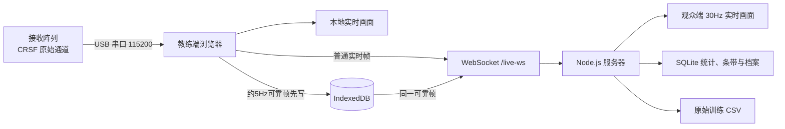

# FPV 赛事与训练系统

面向 FPV 训练、教学和赛事现场的一体化 Web 系统。系统包含训练接收阵列、教练端、观众端、训练档案、智能备课、AI 助教、历史总结、技能树、赛道与搬运规划、双败淘汰赛，以及带双 Betaflight 内核的车队地面站。

项目采用 React + Node.js + SQLite，训练数据由教练端通过 Web Serial 接收，再通过同源 WebSocket 实时转发给服务器和观众端。

## 核心能力

| 模块 | 主要功能 |
| --- | --- |
| 实时训练 | 最多 16 个接收机、8 通道摇杆数据、30Hz 实时画面、解锁/飞行/反乌龟状态、条带与利用率 |
| 观众端 | 与教练端共享同一批实时数据，支持断线后取得最新快照、状态同步和服务器下行压力监测 |
| 飞手档案 | Rate 参数、AUX 通道范围、技能星级、成长记录、教练分层与评估 |
| 训练事件 | 飞手、接收机、图传频道、参训起止时间、训练中接收机迁移、事件开始和结束 |
| 智能备课 | 技能目标、课堂时间轴、教练动作、天气、教学资料、预算模板和 AI 学案 |
| AI 助教 | OpenAI 兼容接口、飞手状态建议、整场总结、智能播报和异常提醒 |
| 历史记录 | 历史条带、飞行统计、接收机迁移、教练评语、AI 总结、误录数据修剪和事件删除 |
| 训练实况 | 教练拍照或上传图片、横向展示、全屏预览、手动旋转和删除 |
| 技能树 | 多级技能节点、星级标准、导入导出和观众端只读展示 |
| 赛道管理 | TrackDraw 同步、赛道图片、器材识别、人工纠正和未知物体处理 |
| 搬运规划 | 人数、推车、趟数、沙袋拆分、任务协作、甘特图和人员分配 |
| 淘汰赛 | 4–16 人、1V1 / 3 进 2 / 4 进 2 双败、BYE/余数组自动轮空、音频发令、手动计次和排名 |
| 车队地面站 | 飞控识别、Modern/Legacy Betaflight 自动选择、配置快照、差异、预设、固件和审计 |

## 实时数据架构



### 数据一致性

> [!IMPORTANT]
> **实时监测数据链路属于受保护的稳定核心。** 当前结构经过长期真实环境调试，用来同时满足低延迟显示、断网可靠保存、历史权威一致性和接收机迁移。后续增加页面、指标、AI功能或做性能整理时，默认只能作为现有链路的消费者或旁路功能接入；不得因为“代码更简洁”“减少状态”“统一数据源”等一般性重构理由，改写30Hz实时流、约5Hz可靠帧、IndexedDB先写后发、服务器ACK、SQLite权威历史、回补隔离及最终重建的职责边界。确需改变这些边界时，必须由用户明确授权，并先阅读 [`docs/LIVE_DATA_PIPELINE.md`](./docs/LIVE_DATA_PIPELINE.md)、补齐专项测试和真实环境回归证据。

- 教练端和观众端使用同一批接收阵列数据，不在观众端重新推算另一套摇杆数据。
- 实时摇杆数据按接收阵列输入频率转发，标准工作频率为 30Hz。
- 服务器为实时帧分配连续序号；观众端发现序号跳跃时直接接受最新帧，不追赶已经错过的摇杆帧，优先保证低延迟。
- 在线30Hz流中约每200ms选一帧升级为可靠帧；该帧先写入浏览器 IndexedDB，再由同一份 WebSocket 消息同时完成实时广播与服务器历史落库。服务器ACK并完成本地删除后，浏览器才移除缓存。
- 教练端临时断网时，可靠帧继续保留在 IndexedDB；恢复连接后使用 `backfill + persistOnly` 按数据包 ID 补传，服务器负责去重。过去的包不会重新广播成当前画面，断线期间错过的实时画面也不会快速补播。
- 每个观众连接最多保留一份尚未发出的最新摇杆帧和一份最新状态；连接拥塞时新帧直接覆盖旧帧，重连也只取得最新快照，避免历史队列拖垮教练端。
- 普通30Hz帧只负责最新画面；其中约5Hz被选中的可靠帧同时进入ACK、CSV、SQLite、条带和统计链路，不再在线额外发送第二份 `persistOnly` 数据。服务器仍会合并同一200ms窗口中的重复候选，避免形成无界积压。
- 实时页面首次进入、重新连接、重新回到前台或教练端完成断线补传后读取一次服务器已保存的完整统计和条带；正常直播阶段只接收统计及条带增量，不反复下载全部历史采样。

### 保存精度

- 实时转发使用接收阵列的包级数据，标准为 30Hz；网络拥塞时只保留最新实时帧，不追赶旧画面。
- CSV、SQLite、条带和统计采用约 200ms 一次的同源采样，即约 5Hz。教练端会为每个近期在线的接收机分别保留最新值，再合成一次完整阵列快照；即使硬件串口包只包含一个或部分接收机，也不会因为多路轮询而漏掉某些飞手。5Hz 是设计保存频率，不是服务器阻塞后的随机掉帧。
- 飞行、待机、反乌龟状态由服务器使用同一批约5Hz权威历史采样判定；飞行规则固定为“当前已解锁，且最近5秒原始油门最大值与最小值之差大于80”。不得改成绝对油门、摇杆偏移、客户端上传状态或延时保持。为避免5Hz抽样遗漏30Hz中的油门极值，每个可靠帧只额外携带该200ms窗口内真实出现过的最低/最高油门原始记录，SQLite仍只增加同一行的两个原始极值字段，不提高落库频率。相邻采样持续连接为条带，接收机迁移按采集时间选择当时的归属。
- CSV 与 SQLite 共用同一次状态判定，避免九路接收机下重复解析；条带和统计在服务端持续累计，不依赖页面是否停留在实时监测标签。
- 单个采样间隔超过 1 秒时不会被强行连接成连续条带，防止断线期间产生虚假的飞行时长。

核心数据所有权、断网恢复顺序、已踩过的坑和修改验证要求见 [实时训练核心数据链路](./docs/LIVE_DATA_PIPELINE.md)；代码代理还须遵守仓库根目录的 [AGENTS.md](./AGENTS.md)。

## 使用角色

### 观众

首页可直接进入：

- 训练赛道
- 训练状态监测
- 技能树
- 双败淘汰赛
- 车队地面站访客功能

观众端主要为只读展示。实时监测中的教练任务区需要教练密码才能操作。

### 教练

从首页进入“教练模式”并输入 `COACH_PASSWORD`。教练系统包括：

- 技能树管理
- 飞手档案
- 事件和系统
- 赛道管理
- 实时监测
- AI 助教
- 历史记录

教练密码保存在当前浏览器标签页的 `sessionStorage` 中，关闭标签页后不会长期保留。

### 车队成员

车队地面站使用独立的 `TEAM_PASSWORD`。教练密码拥有更高权限，可管理预设、固件、删除和审计等功能。

## 运行要求

- Node.js 24，推荐使用当前 Node.js 24 LTS
- npm
- Chrome 或 Edge
- 接收阵列串口：115200 baud
- Web Serial、相机和麦克风等浏览器能力需要 HTTPS；本机开发可使用 `localhost`
- 生产环境反向代理必须正确转发 WebSocket `/live-ws`

Safari、Firefox 以及普通 HTTP 域名不能保证 Web Serial 可用。

## 快速开始

### 1. 安装依赖

```bash
npm install
```

### 2. 配置本地环境

在项目根目录创建 `.env`：

```dotenv
HOST=0.0.0.0
PORT=3000
COACH_PASSWORD=请替换为高强度教练密码
TEAM_PASSWORD=请替换为不同的车队密码
SERVER_DOWNLINK_MBPS=3
```

服务器依次读取 `.env` 和 `.env.local`，系统环境变量优先级更高。这两个文件已被 Git 忽略，不要提交真实密码和密钥。

### 3. 开发运行

```bash
npm run dev
```

该命令同时启动：

- API 与 WebSocket 服务：`http://127.0.0.1:3000`
- Vite 开发页面：通常为 `http://127.0.0.1:5173`

Vite 会代理 `/api` 和 `/uploads` 到 3000 端口。

### 4. 本地生产运行

```bash
npm run build
npm start
```

访问：

```text
http://localhost:3000
```

## 环境变量

| 变量 | 必填 | 默认值 | 说明 |
| --- | --- | --- | --- |
| `HOST` | 否 | `0.0.0.0` | HTTP 监听地址 |
| `PORT` | 否 | `3000` | HTTP 和 WebSocket 端口 |
| `COACH_PASSWORD` | 生产必填 | 无 | 教练功能及受保护接口密码 |
| `TEAM_PASSWORD` | 使用车队库时必填 | 无 | 车队成员密码 |
| `SERVER_DOWNLINK_MBPS` | 否 | `3` | 服务器可用下行带宽，用于计算观众下载压力 |
| `AUDIENCE_BANDWIDTH_SAFETY_RATIO` | 否 | `0.7` | 观众实时流可占服务器下行的安全比例；带宽不足时自动丢弃中间帧 |
| `TRACKDRAW_API_KEY` | 使用 TrackDraw 时必填 | 无 | TrackDraw 后端 API Key |
| `TRACKDRAW_API_BASE_URL` | 否 | `https://trackdraw.app` | TrackDraw API 基地址 |
| `QWEATHER_API_HOST` | 使用天气时必填 | 无 | 和风天气凭据对应的 API Host |
| `QWEATHER_PROJECT_ID` | 使用天气时必填 | 无 | 和风天气 Project ID |
| `QWEATHER_CREDENTIAL_ID` | 使用天气时必填 | 无 | 和风天气 Credential ID |
| `QWEATHER_PRIVATE_KEY_BASE64` | 三选一 | 无 | Base64 编码的 Ed25519 私钥 |
| `QWEATHER_PRIVATE_KEY` | 三选一 | 无 | PEM 私钥，可用 `\n` 表示换行 |
| `QWEATHER_PRIVATE_KEY_PATH` | 三选一 | 无 | PEM 私钥文件路径 |
| `BETAFLIGHT_MODERN_DIST_DIR` | 否 | `betaflight-dist` | Modern Betaflight 构建目录 |
| `BETAFLIGHT_LEGACY_DIST_DIR` | 否 | `betaflight-legacy-dist` | Legacy Betaflight 构建目录 |
| `BETAFLIGHT_DIST_DIR` | 否 | 无 | Modern 目录的旧兼容变量 |

和风天气示例：

```dotenv
QWEATHER_API_HOST=你的专属APIHost
QWEATHER_PROJECT_ID=你的ProjectID
QWEATHER_CREDENTIAL_ID=你的CredentialID
QWEATHER_PRIVATE_KEY_BASE64=Base64编码后的Ed25519私钥
```

大模型地址、模型名、API Key、超时、自动分析间隔和系统提示词在“AI 助教”页面设置，并保存在服务器 SQLite 中。备课、AI 助教和历史总结各自保存最近一次提示词或配置，后续事件会自动复用。

## 标准训练流程

1. 在“飞手档案”创建飞手，配置 Rate、备注以及 CH5–CH8 的解锁、模式和反乌龟范围。
2. 在“技能树管理”建立训练技能和星级标准。
3. 在“事件和系统”新建训练事件，选择飞手、接收机和图传频道。
4. 如需智能备课，设置教学目标、参训时间、天气位置和 AI 资料，保存或生成学案。
5. 使用 Chrome/Edge 打开教练端，点击“连接阵列”并选择串口；已授权的训练阵列可自动重连。
6. 开始训练后，在“实时监测”查看摇杆、状态条带、飞行时长、利用率、距上次飞行和教练任务。
7. 需要时拍照或上传训练实况。图片可在手机、平板和电脑上全屏预览，并可手动旋转。
8. 训练结束后点击“结束训练”，再到“历史记录”填写教练评语或生成 AI 总结。
9. 如忘记结束训练，在历史事件列表中设置正确结束时间并确认修剪；系统会删除该时间之后的采样并重新计算统计。

## 接收机迁移与参训时间

- 训练过程中修改飞手的接收机，会结束旧接收机分配并建立新的分配记录。
- 历史记录按时间显示接收机迁移，例如 `1 → 2`。
- 实时数据、CSV、条带和历史统计按采样发生时有效的“接收机—飞手”关系归属。
- 飞手参训开始和结束时间用于利用率计算及事件统计窗口，不会改写接收阵列已经产生的原始摇杆数据。
- 只设置参训开始时间时，统计窗口从该时间计算到当前时间或训练结束。
- 手动设置参训结束时间后，利用率统计窗口固定；“距上次”仍依据最后一次实际飞行结束时间显示。

## 接收阵列协议

STM32F405 接收阵列固件源码、角色配置和构建说明见 [hardware/f405-receiver-hub](./hardware/f405-receiver-hub/README.md)。该目录是固件工程，不含原理图和 PCB 文件。

浏览器读取以换行分隔的 JSON，每行可以是单接收机对象，也可以是批量对象。推荐批量格式：

```json
{
  "type": "rx_batch",
  "v": 1,
  "t": 12345678,
  "Vin_mV": 5000,
  "A_mA": 576,
  "items": [
    {
      "rx": 1,
      "ch": [992, 992, 172, 992, 172, 992, 172, 172],
      "lq": 99,
      "rssi": -48,
      "t": 12345678
    }
  ]
}
```

协议约束：

- `rx`：接收机编号，从 1 开始
- `ch`：至少 8 个通道
- 通道值：CRSF 原始范围 172–1811；系统内部转换为约 1000–2000 PWM
- `lq`：链路质量
- `rssi`：信号强度
- `t`：设备启动后的单调毫秒时钟（不是 Unix 时间戳）；浏览器用它还原积压串口帧间隔
- `Vin_mV`、`A_mA`：阵列电压和电流，可选
- 默认 CH5 为解锁、CH6 为模式、CH7 为反乌龟；具体范围以飞手档案配置为准

系统自动识别 USB VID:PID `0483:5740` 为 `TRAINING_HUB`，授权后可自动重连。手动连接时允许选择其他串口。

## 虚拟接收阵列

测试脚本不安装 com0com，不创建虚拟 COM，不需要管理员权限；它直接使用与真实阵列相同的 JSON 协议连接 `/live-ws`。

Windows 下可双击：

```text
scripts/start-virtual-receiver.bat
```

默认连接线上服务 `wss://app.1.gzfpv.cn/live-ws`，模拟 8 个接收机、30Hz，并周期性产生待机、解锁、飞行和反乌龟状态。

PowerShell 自定义：

```powershell
.\scripts\start-virtual-receiver.ps1 -Receivers 12 -RateHz 30
```

连接本地服务：

```powershell
.\scripts\start-virtual-receiver.ps1 -RelayUrl ws://127.0.0.1:3000/live-ws
```

只输出协议样例：

```powershell
node .\scripts\virtual-receiver-array.mjs --stdout --receivers 4 --rate 30 --count 5
```

关闭窗口或按 `Ctrl+C` 即停止，不会留下端口占用。更多说明见 [虚拟接收阵列文档](./docs/VIRTUAL_RECEIVER_ARRAY.md)。

## 实时监测与带宽

“事件和系统”的日志区会显示：

- CSV 排队行数与字节数
- CSV 文件大小和最近写入状态
- 服务器可靠入库队列、最老积压时间、最近和峰值处理耗时
- 观众人数
- 估算下行速率
- 相对 `SERVER_DOWNLINK_MBPS` 的带宽使用率
- 观众实时目标帧率（正常为 30Hz）
- WebSocket 连接积压
- 丢弃的旧实时帧数量

如果观众端断续或服务器下行长期接近 100%，优先检查：

1. 反向代理是否正确升级 WebSocket，而不是退化为普通 HTTP。
2. 是否有大量观众同时打开实时监测。
3. `SERVER_DOWNLINK_MBPS` 是否与服务器真实出口一致；该值用于压力提示。健康连接仍按 30Hz 发送，真正出现写入背压时才用新帧覆盖该观众尚未发出的旧帧。
4. 浏览器和代理是否存在异常缓存或连接限速。
5. 教练端本地缓存是否正在补传；补传的是5Hz历史采样，不会作为实时旧包重新广播给观众。
6. 如果教练端本地摇杆正常、但观众画面和服务器统计同时停止，查看“服务器实时入库”。正常在线队列应长期为0或1；“已合并旧包”持续增加表示有旧客户端仍在提交高频入库数据，但服务器会主动合并而不会积压。

## 训练数据、历史修剪与删除

历史事件支持：

- 查看每位飞手的状态条带和统计
- 查看接收机迁移记录
- 保存教练评语并同步成长记录
- 生成单个飞手或全班 AI 总结
- 修剪错误的训练结束时间
- 删除整个训练事件

修剪会删除指定结束时间之后的采样、条带、接收机分配和已接收数据包记录，并重新计算事件统计。删除事件会同时删除其训练样本、统计、条带、接收机分配和训练实况图片。执行前应先备份 `data/`。

## 原始 CSV

文件位置：

```text
data/training-joystick-samples.csv
```

主要字段包括事件、飞手、接收机、状态、模式、LQ、RSSI、CRSF 原始 CH1–CH8 和转换后的 PWM CH1–CH8。CSV 使用与 SQLite、条带、统计相同的约5Hz采样，并异步批量追加；30Hz实时画面不会逐包同步写磁盘。

## 赛道与 TrackDraw

TrackDraw API Key 只配置在服务器环境变量中，不要写入前端代码。

系统同步：

- 项目信息
- `track`
- `overlay`
- 场地尺寸和赛道长度
- 器材与未知对象

当前自动识别规则包括普通门、重力门、太阳门、三重门/μ 门、双重力门、沙袋和旗帜。识别后可人工纠正数量，再根据人数、推车、单趟上限和协作规则计算搬运计划。观众端只显示当前赛道和已选中的搬运方案。

## 淘汰赛

- 支持 4–16 名选手
- 可选 1V1 双败、3 进 2 双败、4 进 2 双败三种赛制；所有赛制均包含胜者组、败者组、总决赛和必要时的重置加赛
- 支持非 2 的幂人数
- 选择赛制和人数后显示实际需要进行的比赛局数，并单独说明触发总决赛重赛时的总局数
- 使用种子顺序和 BYE 自动轮空
- 自动推进胜者组、败者组、总决赛和必要时的重置加赛
- 多人赛按每组前 2 名推进，胜者组未晋级者进入败者组，败者组再次未晋级才被淘汰；余数组人数不足时自动轮空
- 支持圈数、用时、DNF 和平局手动裁定
- 教练端提供统一风格的比赛计时卡片；发令把 1 秒静音唤醒、三声预备音、随机等待和开始音合成为一条连续音频流，避免蓝牙刚唤醒时吞掉短音。合成参数与 RotorHazard 默认值一致：预备音为 440Hz 三角波（100ms 保持、1s 指数淡出），开始音为 880Hz 三角波（700ms 保持、250ms 指数淡出）。计时会按浏览器报告的音频设备输出时刻校准蓝牙延迟，并在开始音传播与反应补偿后启动；“停止”仅暂停，“继续”保留已有用时和圈数，只有“归零”清空本局
- 手动计次的前两圈仅保存过圈进度，选手达到第 3 圈后才形成完赛成绩，全部选手完赛后才推进对阵
- 存在进行中的训练记录时，赛事名单和对阵树按飞手自动同步该训练的图传频点，并隐藏手动频点框；没有进行中的训练时才允许赛事名单手动指定频点
- 对阵卡片仅显示简短中文名称；当前对局使用橙色呼吸提示，下一场使用蓝色提示。正常完赛后自动切换下一局；教练可双击选手已经确定的对局并确认，临时手动调整成绩或归零重赛，含待定选手的对局禁止手动切换，完成后恢复自动切局
- 树状图空白处可拖动画布，隐藏滚动条，鼠标滚轮以指针位置为中心平滑缩放；观众页顶部显示实时排名和同步计时卡片，不显示选手名单编辑卡片
- 教练端修改后保存到 `data/bracket-state.json`
- 观众端每秒读取服务器 JSON，不占用训练实时数据连接
- 从训练系统进入双败赛时，训练系统保持挂载，避免切页导致串口和实时监测断开

## AI、天气与播报

### AI

系统支持 OpenAI 兼容的 Chat Completions 接口，包括 DeepSeek 等兼容服务。API Key 通过教练页面保存到服务器数据库，公共页面不会读取完整 Key。

三类 AI 配置分别保存：

- 智能备课：教学提示词、教学方法手册、补充资料和预算模板
- AI 助教：模型接口、状态建议提示词和自动分析间隔
- 历史总结：是否包含任务、评语以及总结提示词

### 天气

智能备课可使用和风天气查询逐小时天气和分钟级降水。经纬度保留输入精度并保存为后续事件默认值。若出现 `QWeather request failed`，检查 API Host、Project ID、Credential ID、Ed25519 私钥以及该凭据开通的数据接口。

### 播报

教练端支持训练节奏、长时间待机、反乌龟、长时间飞行、接收机离线、AI 建议和自定义消息播报。浏览器语音能力和自动播放策略可能要求先进行一次用户交互。

## 车队地面站

入口：

```text
/ground-station
```

系统内置两个定制内核：

- Modern：Betaflight App 2026.6，MSP API 1.44–1.48
- Legacy：Betaflight Configurator 10.10，MSP API 1.41–1.46

Agent 是唯一可见连接入口。当前 Betaflight iframe 持有 Web Serial，识别 API 版本后选择对应内核，并将统一配置快照返回训练系统。地面站可保存调参前、中、后快照，记录原生保存事件，生成配置差异，并管理飞手、飞机、飞控、预设、固件和审计日志。

详细结构及升级规则见 [车队地面站架构](./docs/GROUND_STATION_ARCHITECTURE.md)。

## 数据目录与备份

所有需要持久化的数据都位于：

```text
data/
├── training.db
├── training-joystick-samples.csv
├── bracket-state.json
└── uploads/
    ├── tracks/
    └── training/
```

部分旧版本迁移文件可能还包括 `pilots.json` 和 `events.json`。

备份时应复制整个 `data/`，而不是只复制 SQLite 文件。SQLite 使用 WAL 模式；在线备份时还应考虑同目录下的 `training.db-wal` 和 `training.db-shm`，最稳妥的方式是在短暂停止容器后复制整个目录。

恢复时：

1. 停止服务。
2. 用备份替换完整 `data/`。
3. 确认运行用户具有读写权限。
4. 启动服务并检查飞手、事件、图片、赛道和地面站历史。

## Docker 与 1Panel

`Dockerfile` 使用多阶段构建，同时生成：

- 训练系统前端与 Node.js 服务器
- Modern Betaflight
- Legacy Betaflight

启动：

```bash
docker compose -f compose.1panel.yml build
docker compose -f compose.1panel.yml up -d
```

Compose 将宿主机 `./data` 挂载到容器 `/app/data`。不要额外挂载旧的 `/app/betaflight-dist` 或 `/app/betaflight-legacy-dist`，否则旧目录会覆盖镜像中的新构建。

完整的备份、替换和 1Panel 更新步骤见 [1Panel 部署文档](./docs/1PANEL_DEPLOYMENT.md)。

### 反向代理要求

除普通 HTTP 代理外，必须允许 `/live-ws` 升级为 WebSocket。Nginx 示例：

```nginx
location / {
    proxy_pass http://127.0.0.1:3000;
    proxy_http_version 1.1;
    proxy_set_header Host $host;
    proxy_set_header X-Forwarded-For $proxy_add_x_forwarded_for;
    proxy_set_header X-Forwarded-Proto $scheme;
}

location /live-ws {
    proxy_pass http://127.0.0.1:3000;
    proxy_http_version 1.1;
    proxy_set_header Upgrade $http_upgrade;
    proxy_set_header Connection "upgrade";
    proxy_set_header Host $host;
    proxy_read_timeout 3600s;
    proxy_send_timeout 3600s;
    proxy_buffering off;
}
```

生产域名应启用 HTTPS，否则 Web Serial 和相机权限可能不可用。

## 验证命令

```bash
# ESLint
npm run lint

# 生产构建
npm run build

# 实时中继、断线补传、接收机迁移、修剪和带宽指标
npm run verify:training-live

# 虚拟接收阵列协议
npm run verify:virtual-receiver

# 车队地面站数据库、预设、车队、状态和配置语义
npm run verify:ground-station
```

## 项目结构

```text
src/
  App.jsx                         首页、双败淘汰赛和主入口
  TrainingSystem.jsx              串口、实时中继、断线缓存和训练框架
  liveOutbox.js                   浏览器 IndexedDB 待发送队列
  pages/                          教练、观众、历史、赛道、技能树和地面站页面
  groundStation/                  地面站 Agent 与 Betaflight 通信

server.js                         Express/HTTP/WebSocket 组合入口
server/
  database/initializeDatabase.js  SQLite 表结构与迁移
  live/sampleProcessing.js        CRSF 解析、状态判断和实时包压缩
  features/training/              训练持久化、CSV、统计和服务器状态
  features/teaching/              技能、备课、天气、任务和总结
  features/coach/                 教练认证、快照和 LLM
  features/tracks/                赛道、TrackDraw 和搬运规划
  features/groundStation/         车队、快照、预设、固件和审计

scripts/                          开发、验证和虚拟接收阵列脚本
docs/                             专项部署与架构文档
vendor/                           两套定制 Betaflight 源码
data/                             运行数据，不提交 Git
```

## 常见问题

### 浏览器找不到串口

- 使用 Chrome 或 Edge。
- 使用 HTTPS 或 `localhost`。
- 检查 USB 线是否支持数据。
- 首次连接需要手动授权；授权后的 `TRAINING_HUB 0483:5740` 可自动重连。
- 确认串口没有被其他程序占用。

### 教练端有数据，观众端断断续续

- 查看日志中的“观众下载压力”和 WebSocket 积压。
- 检查反向代理的 WebSocket Upgrade。
- 检查服务器出口带宽和观众人数。
- 确认没有旧页面持续占用连接。
- 历史条带以后端统计和条带为准；网络恢复后会补齐已经成功缓存和上传的数据。

### 实时条带出现空白

- 检查输入 FPS、页面 FPS、LQ、RSSI 和串口最后数据时间。
- 超过 1 秒的真实采样间隔会保留为空白，不会伪造连续飞行。
- 查看 CSV 队列是否持续增长或出现写入错误。
- 检查教练浏览器是否正在补传本地缓存。

### 天气接口返回 400

- 核对专属 `QWEATHER_API_HOST`，不要默认使用不匹配的公共 Host。
- 核对 Project ID、Credential ID 和 Ed25519 私钥是否属于同一凭据。
- 检查经纬度范围：经度 -180–180，纬度 -90–90。
- 修改环境变量后重启后端。

### AI 请求失败

- 在“AI 助教”确认接口地址、模型名和 API Key。
- 确认服务端可以访问模型接口。
- 检查超时、返回格式和模型是否支持当前请求。
- 教练页面会保存最近一次有效配置，不需要每次重新输入。

## 安全说明

- 不要提交 `.env`、私钥、数据库、训练 CSV 或上传图片。
- 公网部署必须使用高强度且不同的 `COACH_PASSWORD` 与 `TEAM_PASSWORD`。
- 教练密码是项目级口令，不是完整的多用户身份系统；需要更严格隔离时，应在反向代理增加访问控制、IP 白名单或统一认证。
- 定期备份 `data/`，并在升级前验证备份可恢复。
- 删除事件和修剪历史会删除实际训练数据，操作前确认目标事件与时间。

## 相关文档

- [实时训练核心数据链路](./docs/LIVE_DATA_PIPELINE.md)

- [虚拟接收阵列](./docs/VIRTUAL_RECEIVER_ARRAY.md)
- [1Panel 部署定制 Betaflight](./docs/1PANEL_DEPLOYMENT.md)
- [车队地面站代码结构](./docs/GROUND_STATION_ARCHITECTURE.md)
- [后端模块说明](./server/README.md)
